# Turntable-1

**Your record player as internet radio, with a listening log, your Discogs collection, an album archive, and Beepnik: a small satellite that lives on your listening.**

Plug a USB turntable into a Raspberry Pi (or any Linux machine) and Turntable-1 streams whatever you play to your browser, phone, TV and speakers. It recognizes each track, matches it to your record collection, logs every side you play, records your sessions, quietly builds a digital archive of your albums, and gives your listening a companion who reacts to it.


> The screenshots show a demo station: fictional artists and generated cover art.

## Contents

- [Features](#features)
- [A tour](#a-tour)
- [How it works](#how-it-works)
- [Meet Beepnik](#meet-beepnik)
- [What you need](#what-you-need)
- [Quick start](#quick-start)
- [Configuration](#configuration)
- [Phones, TVs and speakers](#phones-tvs-and-speakers)
- [Home Assistant](#home-assistant)
- [Running it on the internet](#running-it-on-the-internet)
- [Updating and backups](#updating-and-backups)
- [Troubleshooting](#troubleshooting)
- [Project layout](#project-layout)
- [Credits and legal notes](#credits-and-legal-notes)

## Features

**Listening**
- **Live stream** of your turntable at up to 320 kbps MP3, playable in any browser, on Cast devices, or in the Android apps.
- **Track identification** every 20 seconds, with tracks it can't hear (quiet intros, segues) filled in from the record's tracklist and the gaps between songs.
- **Your Discogs collection,** synced nightly: covers, tracklists, pressings, original release years, conditions and your wantlist.
- **The play log:** every side you play, which tracks, how long, matched to your copy of the record. Fix a misidentified play in two taps.

**Remembering**
- **Session recordings:** every listening session, kept for playback (the last five, by default).
- **The album archive:** when a side plays through, it's cut into tagged MP3 tracks with cover art, filed as `Artist/Album (Year)/01 - Title.mp3` on your NAS. Your vinyl slowly becomes a digital library, ready for Plex, Jellyfin or Music Assistant.
- **The Flight log:** a radar of your listening by day and hour, prime time, busiest day, longest session, and a stylus-wear counter.
- **The Cosmic logbook:** your collection as a star map, one constellation per genre, brighter stars for the records you play most.
- **Record pages:** each record with your history (spins, time listened, a 12-week chart), play counts per track, Beepnik's verdict, the records you often spin with it, and Ground Control's dossier of credits, pressing and matrix numbers.
- **Playback in the Now card:** play back any recorded album, track or listening session, and the Now card becomes the player, with the recording's cover spinning on the platter. On a TV it takes over the Now stage, all by remote.
- **One sleeve per album:** pressings of the same album (the same Discogs master, or the same artist and title) share one sleeve in the cargo hold, with their history combined; each pressing stays a tap away on the record's page. A setting, on by default.

**Beepnik**
- A companion with four needs (fuel, variety, curiosity and taste) that rise and fall with what and how often you play.
- Climbs to higher orbits when you play whole sides, earns new equipment as you keep coming back, gets survey missions, develops tastes, and comments on your listening through a language model (local or free online).
- **Talk to him:** ask him for a record (he picks one from your cargo for his lowest need, and says why), or ask how he's doing.
- **His journey and achievements:** a timeline of his milestones, a week's history of each need, and 21 achievements across your listening and his flight, which he announces as they're earned.
- **Ground Control** reads out each track's story: credits, pressing details, how often you've played it.

**Everywhere**
- A tabbed dashboard (Now, Beepnik, Log, Cargo, Stars) on desktop and phone, a TV view for Google TV that's fully remote-driven, a Google Cast receiver, and Android apps for phones and TVs with background playback.
- A settings page for everything, behind an admin sign-in.
- One `docker compose up` to run it all.

## A tour

| | |
| --- | --- |
| 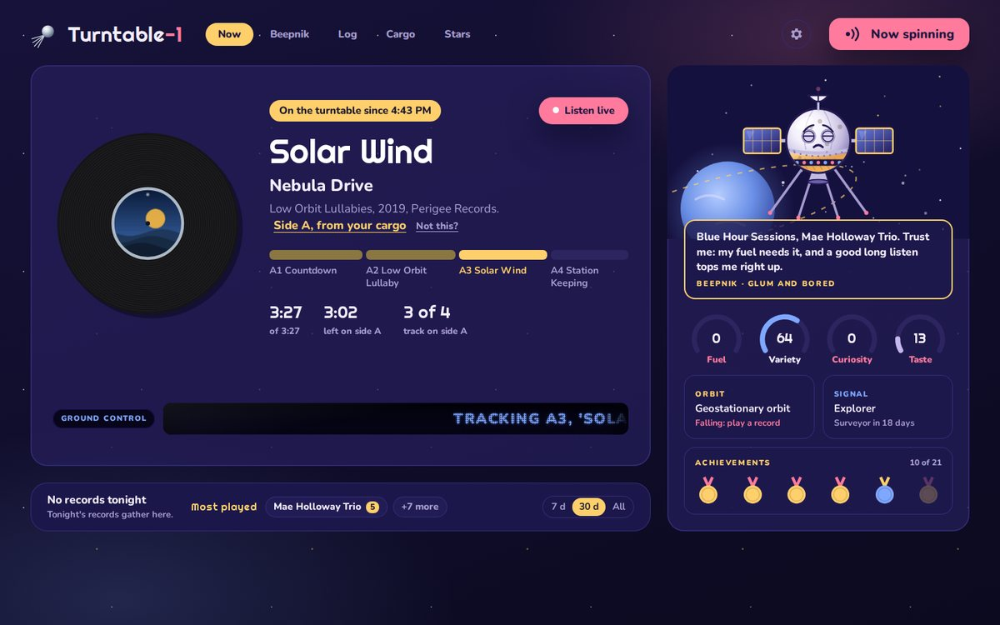 **Now playing.** The record spins with live readouts for the track and the side, Ground Control relays each track, and Beepnik keeps you company alongside. | 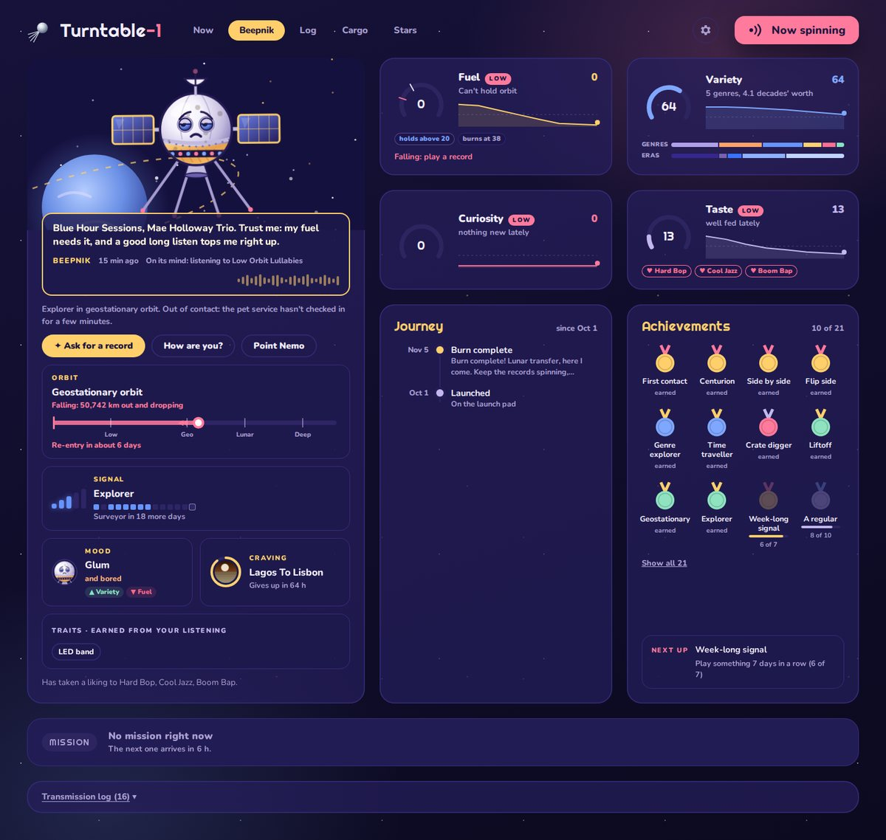 **Beepnik.** His needs with a week's history each, his orbit, signal, mood and craving, his journey and achievements, and buttons to talk to him. Every need opens a breakdown. |
| 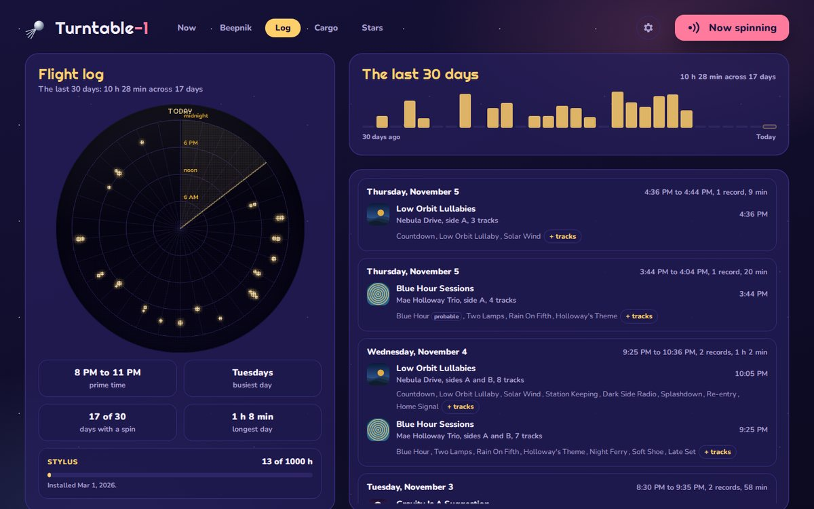 **The Flight log.** A month of listening on a radar and as daily bars, with sessions you can play back and fix. | 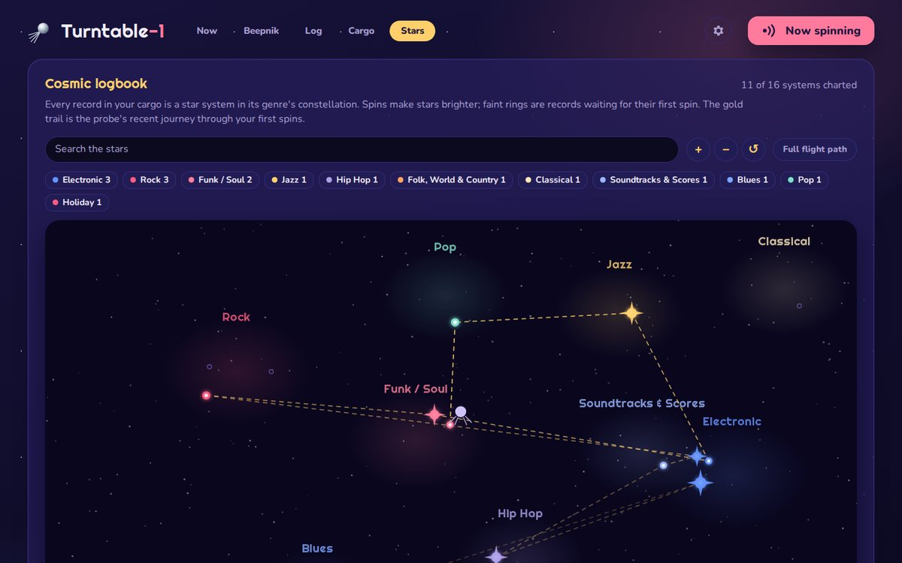 **The Cosmic logbook.** Your collection as constellations, with the probe's recent journey traced in gold. |
| 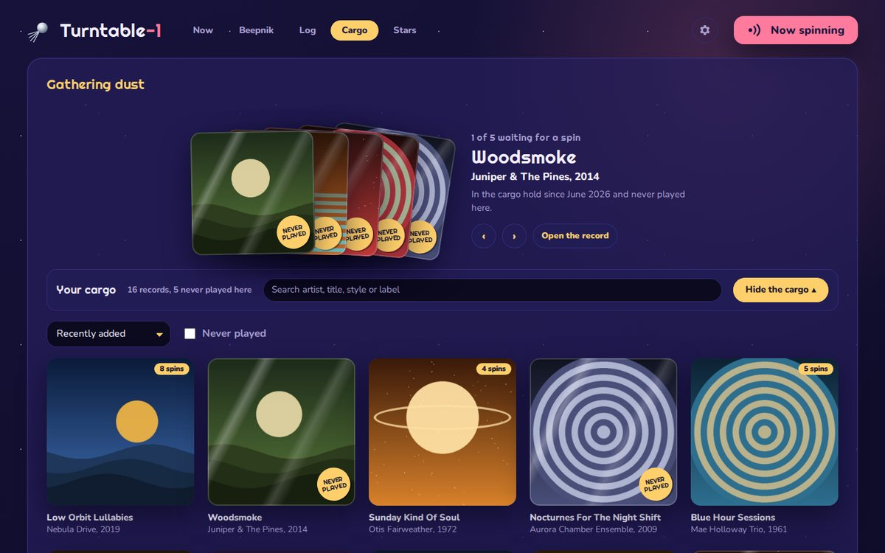 **The cargo hold.** Your collection, one sleeve per album, with a crate dig of records waiting for a spin. | 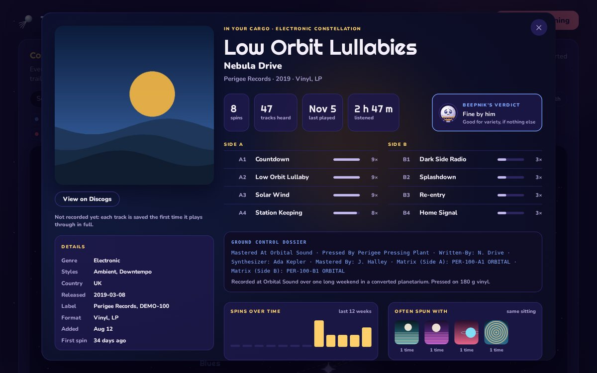 **A record.** Your history with it, play counts per track, Beepnik's verdict, Ground Control's dossier, and, once archived, the album to play. |

**On a phone,** the same dashboard rearranges into five tabs: Now, Beepnik, Log, Cargo and Stars.

<p>
  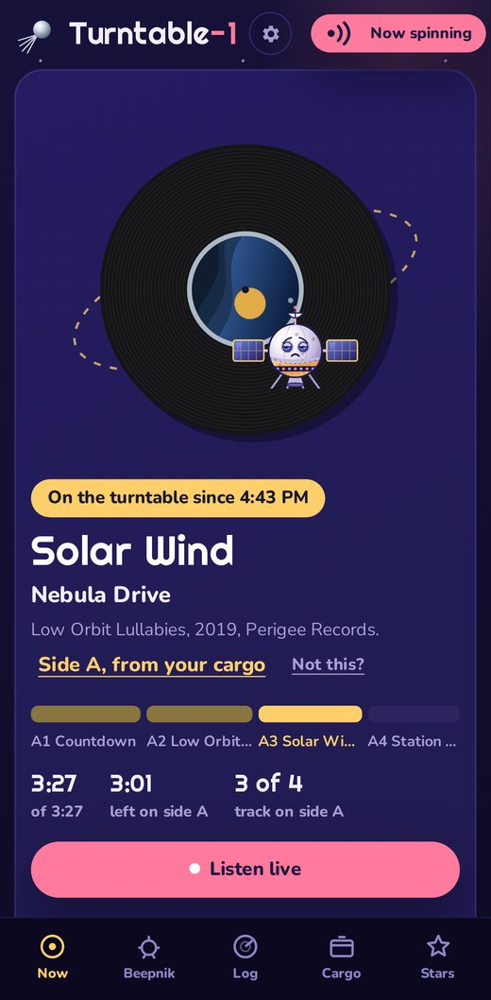
  &nbsp;
  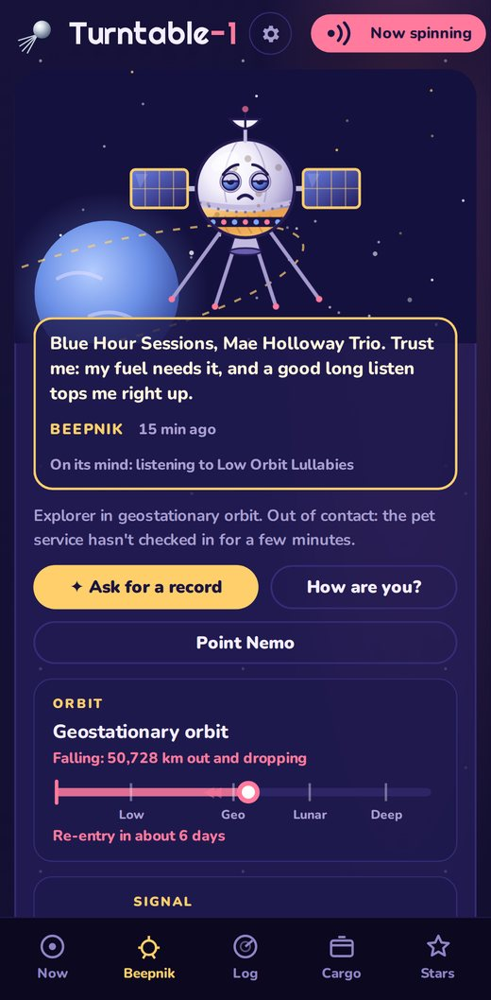
</p>

**On a TV,** a ten-foot view built for across the room. Everything works with a remote, including asking Beepnik for a record:

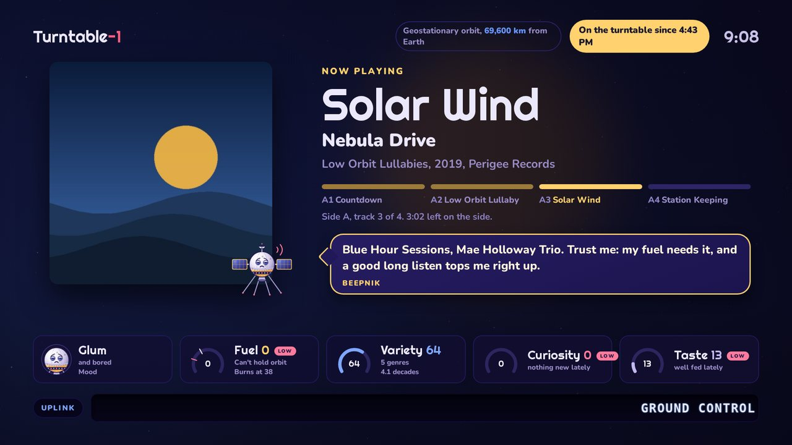
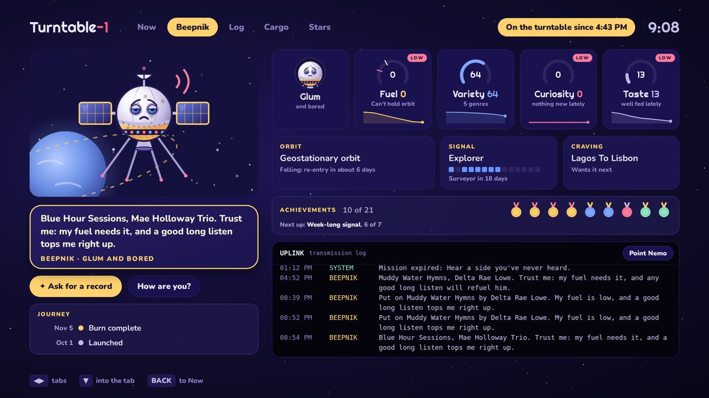

**Settings** cover everything, with validation, defaults, and which changes apply right away:

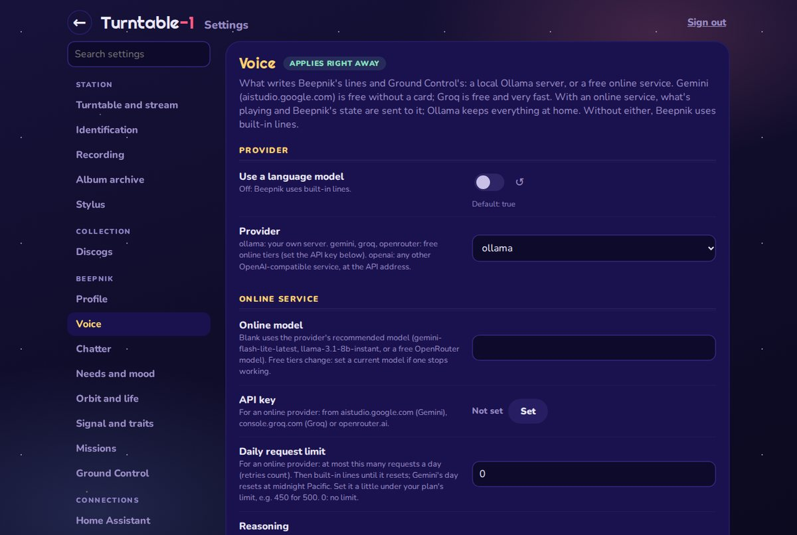

## How it works

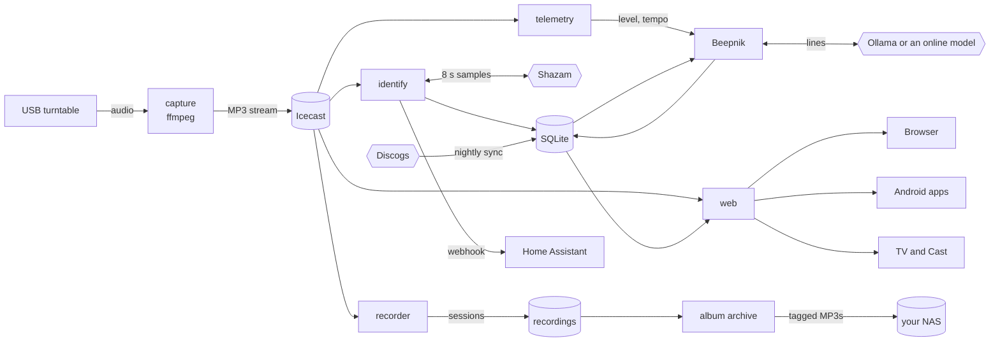

The turntable's audio is captured once and streamed through Icecast. Everything else listens to that stream: the **identifier** samples it, the **recorder** keeps sessions, **telemetry** measures level and tempo for the animations, and the **web app** relays it to your browser. All the state lives in one SQLite database, which the site reads.

### Identifying what's playing

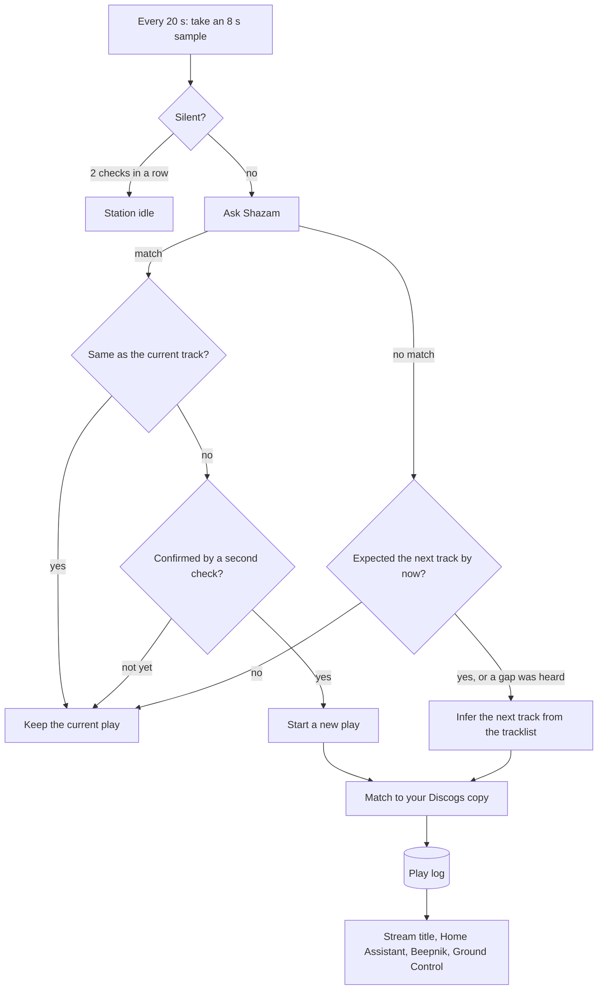

A new track must be heard twice before it replaces the current one, so a single odd match doesn't split a song. Tracks Shazam can't hear are filled in from the record's tracklist and the silence between songs, marked *probable* in the log so you can tell them apart.

### The album archive

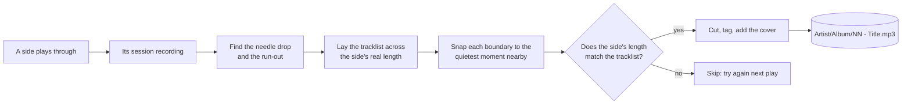

Working a whole side at a time handles albums whose tracks run into each other: the lead-in and run-out grooves are always quiet, so the side's edges are reliable, and the tracklist does the rest. The first complete recording of each track is kept; MP3s are copied straight from the recording, never re-encoded.

### The data

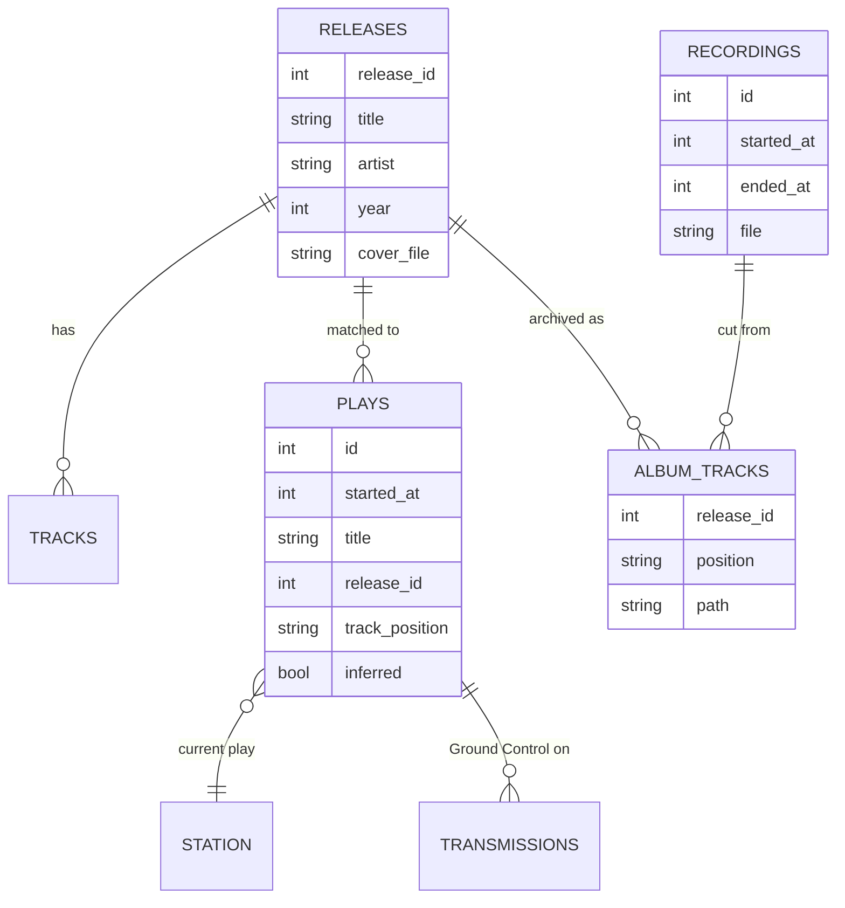

## Meet Beepnik

Beepnik is a small probe in orbit around your listening. He starts as an egg on the launch pad and hatches once he's had some music.

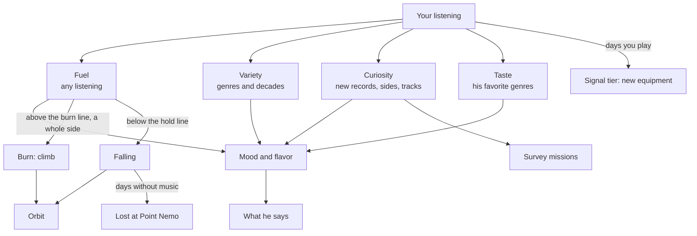

**His needs**

| Need | Fed by | Drains with |
| --- | --- | --- |
| **Fuel** | Any listening; fills in about an hour of play | Silence, slowly |
| **Variety** | A balanced mix of genres and decades | Playing the same style over and over |
| **Curiosity** | Records, sides and tracks you've never played; records you haven't touched in 60 days; missions | Replaying the same few records; it fades without discoveries |
| **Taste** | Records in the genres he's grown fond of | Time away from his favorites |

**His orbit** rises when you play whole sides with fuel to spare (a *burn*), and slips when his fuel can't hold it:

| Stage | From |
| --- | --- |
| On the launch pad | 0 |
| Low Earth orbit | 2 |
| Geostationary orbit | 5 |
| Lunar transfer | 10 |
| Deep space | 20 |

Leave the turntable silent long enough and he re-enters, then is lost at **Point Nemo**, the spacecraft cemetery, where his generation's record is kept. A new egg launches with the next record.

**His signal** grows with the days you play, and each tier adds equipment to his drawing: **Beacon** (0 days), **Relay** (5), **Explorer** (15), **Surveyor** (40), **Array** (60), **Voyager** (80) and **Observatory** (100). Tiers never go down.

**Traits** reflect what you play: a genre that makes up a quarter of your recent listening gives him its look (a film strip for soundtracks, fairy lights for holiday records, and so on). Missions earn patches for his wings; time in space weathers him.

**His voice** comes from a language model, told his needs, mood and what's playing. Choose under **Language model** in settings:

| Provider | Cost | Notes |
| --- | --- | --- |
| [Ollama](https://ollama.com) | Free, on your own hardware | Everything stays at home. A small model like `llama3.2:3b` is plenty |
| [Gemini](https://aistudio.google.com) | Free tier, no card needed | The easiest start: create an API key in Google AI Studio |
| [Groq](https://console.groq.com) | Free tier | Very fast open models |
| [OpenRouter](https://openrouter.ai) | Several free models | One key, many models |
| Any OpenAI-compatible service | Varies | Set its API address |

With an online service, what's playing and Beepnik's state are sent to that company, and free tiers may use what they receive to improve their products. Free tiers' limits and model names also change; if one stops answering, set a current model under **Online model**. Without any model, Beepnik uses built-in lines.

## What you need

- **A turntable with USB audio,** such as an Audio-Technica AT-LP120X-USB, or any turntable through a USB audio interface or phono preamp with USB.
- **A computer to run it:** a Raspberry Pi 4 or 5 (2 GB or more) works well; any 64-bit Linux machine with Docker does too. Recordings use about 140 MB per hour of listening.
- **Optional:**
  - A [Discogs](https://www.discogs.com) account with your collection, for covers, tracklists and the cargo hold. Highly recommended: most of the magic needs it.
  - A NAS or a large drive, for the album archive.
  - A language model for Beepnik's voice: [Ollama](https://ollama.com) on any machine on your network, or a free online service such as Google's Gemini API.

## Quick start

```bash
curl -fsSL https://github.com/TorinML/turntable-1/releases/latest/download/install.sh | sh
```

The installer sets up Docker if it's missing, creates `~/turntable-1` with your time zone and audio settings filled in, finds your turntable, starts the station, and prints the address to open. Then click the gear at the top and:

1. **Create the admin password.**
2. **Discogs:** your username and a personal access token (Discogs settings, then Developers). The first sync starts within a minute.
3. **Language model** (optional): for Beepnik's voice, either your Ollama address (such as `http://192.168.0.50:11434`), or pick **gemini** as the provider and paste a free API key from [Google AI Studio](https://aistudio.google.com).

Then play a record. The station finds a USB turntable on its own; if yours needs a specific device, set it under **Station**.

**Prefer to do it by hand?** Download `docker-compose.yml` and `.env.example` from the [latest release](https://github.com/TorinML/turntable-1/releases/latest), copy `.env.example` to `.env`, adjust it, create `config`, `data` and `archive` owned by user 1000, and run `docker compose up -d`.

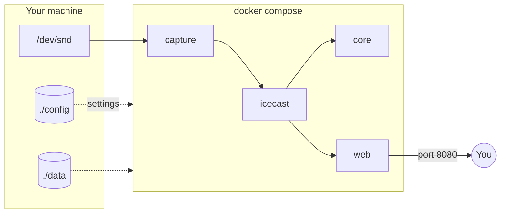

All four containers run the same image. Only the site's port is exposed; the stream is served through it at `/stream`. Your choices for Docker (time zone, port, where data and the archive live, which version) are in `.env`, so `docker-compose.yml` never needs editing. Moving an existing non-Docker install? The installer brings it across; see [MIGRATING.md](MIGRATING.md).

## Configuration

Everything is on the **settings page** (the gear), grouped into sections, each setting with its default and whether it applies right away or after a restart. Behind it are two files in `./config`:

- **`turntable.toml`:** your settings, listing only what differs from the defaults. Fine to edit by hand.
- **`secrets.toml`:** passwords and tokens. The settings page can replace them but never shows them.

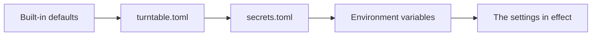

Later layers win. Environment variables take the form `TT_SECTION__KEY`, such as `TT_RECORDING__KEEP_SESSIONS=20`, handy in `docker-compose.yml`.

**The main sections**

| Section | What it covers |
| --- | --- |
| Station | The audio device, sample rate, bitrate, station name |
| Identification | How often to check, sample length, silence threshold |
| Discogs | Username, token, the nightly sync time |
| Recording | Whether to record sessions, how many to keep, minimum free space |
| Album archive | Whether to archive albums (mount your NAS at `/archive`) |
| Web and sign-in | Your public address, trusted proxies, whether editing needs sign-in |
| Beepnik | Name, personality, chatter and quiet hours, needs, orbit, signal tiers, stylus |

## Phones, TVs and speakers

- **Phone browsers** get the tabbed mobile layout automatically.
- **The Android app** ([`android/`](android/)) wraps the site and plays the stream and recordings natively: in the background, with notification and lock-screen controls.
- **The Google TV app** shows the TV view with sound, browsable with the remote. Without it, any TV browser can open `/static/tv.html?audio=1`.
- **Google Cast:** with a Cast receiver app ID (registered at the Google Cast developer console, a one-time $5), a Cast button appears in Chrome: the TV view on screens, the stream on speakers.

Build the apps with Android Studio; see [`android/README.md`](android/README.md).

## Home Assistant

Switch on **Home Assistant** in settings and give it a webhook URL. Each new track is sent with its title, artist, album, cover and whether the station is playing, for automations like turning on the TV, dimming the lights, or showing the cover on a dashboard.

The site's own data is also available as JSON at `/api/now` (what's playing) and `/api/pet` (Beepnik), for REST sensors.

## Running it on the internet

The station is built to be shared through a reverse proxy (Nginx Proxy Manager, Caddy, Traefik). A few things to know:

- **Sign-in:** settings and editing need the admin password. Viewing is open to anyone with the address.
- **Trusted proxies:** add your proxy's address under **Web and sign-in**, so the sign-in's lockout sees real visitors' addresses.
- **Copyright:** a public link to your stream broadcasts the records you play. Whether that's allowed where you live is your responsibility. Keeping the site to your own network, or behind your proxy's authentication, avoids the question.

## Updating and backups

Run the installer again, or, from `~/turntable-1`:

```bash
docker compose pull && docker compose up -d
```

Updates keep your data: the database upgrades itself in place. `TAG` in `.env` picks the version: `latest` (the newest release), a release number like `1.30` to stay on it, or `edge` for the newest development build. The settings page shows which version is running. To back up, copy `./config` and `./data` (stop the stack first for a perfectly consistent copy of the database).

## Troubleshooting

| Symptom | Look at |
| --- | --- |
| No sound, or "Standby" while a record plays | `docker compose logs capture` shows which device it found. Check the host lists the turntable with `arecord -l`, or set the device under Station |
| "Can't write to /config" in the logs | The folders must belong to user 1000: `sudo chown -R 1000:1000 config data archive` in `~/turntable-1` |
| Tracks aren't identified | `docker compose logs core`. Identification needs internet access; quiet passages and live recordings are harder to match |
| The cargo hold is empty | Your Discogs username and token under Discogs; the first sync's progress is in `docker compose logs core` |
| Beepnik only uses stock lines | `docker compose logs core` says why. For Ollama, the address must be reachable from inside Docker (not `localhost`); for an online provider, check the API key, and that the free tier's limit hasn't been reached |
| Album tracks aren't appearing | The archive needs session recordings, a matching tracklist on Discogs, and the side played through |
| Forgot the admin password | Delete the `admin_password_hash` line from `config/secrets.toml` and restart; the site asks you to create a new one |

## Project layout

| Folder | What |
| --- | --- |
| [`turntable-id/`](turntable-id/) | The core: identification, the play log, Beepnik, recording, the archive, the Discogs sync, the config loader |
| [`turntable-web/`](turntable-web/) | The site, its API, the TV view and the settings page |
| [`docker/`](docker/) | The container entrypoint, the core's supervisor, Icecast's config template |
| [`android/`](android/) | The phone app and the Google TV app (one Android Studio project) |

## Credits and legal notes

- **Discogs:** collection data provided by [Discogs](https://www.discogs.com). Turntable-1 isn't affiliated with or endorsed by Discogs.
- **Track identification** uses [shazamio](https://github.com/shazamio/ShazamIO), an unofficial, community library for Shazam's recognition service. It isn't affiliated with Shazam or Apple and may stop working if the service changes.
- **MusicBrainz** fills in original release years and track lengths.
- **Fonts:** [Righteous](https://fonts.google.com/specimen/Righteous) and [Nunito](https://fonts.google.com/specimen/Nunito), under the SIL Open Font License.
- **Streaming:** you're responsible for how you share your stream; see [Running it on the internet](#running-it-on-the-internet).
